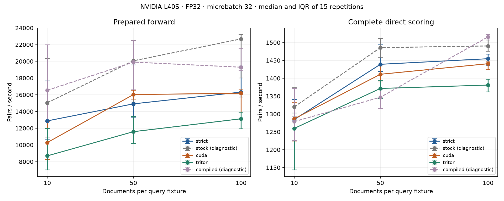

# E17 NVIDIA benchmark results

The restored SSH connection enabled the frozen benchmark on an NVIDIA L40S (`dash2`, Slurm job 172869). Apple HTTP results remain in [REPORT.md](REPORT.md); no NVIDIA HTTP or cross-hardware speedup is claimed.

Original checkpoint SHA-256: `2ea2608a9ec98083b89606d13bed1d7c6e7a90dc6160bbe44732166137538d52`. Plan SHA-256: `71e6c1d92703272a02f8a481bd67f2e720996ba186a66dbd33bf27036ca953fb`. FP32, TF32 disabled, eval/inference_mode, cap 128, pair microbatch 32. Accuracy: all 485 queries at each K, 77,600 pairs/path. Timing: the preselected 16 queries, 15 paired repetitions across five fresh processes, warmed shapes and synchronized GPU boundaries.

## Accuracy

| Path | Strict score tolerance | Application gate | Max absolute error | Changed full lists / top-1 / top-10 membership / order |
|---|---|---|---:|---|
| strict | pass | pass | 0 | 0 / 0 / 0 / 0 |
| stock | fail | FAIL — diagnostic | 0.00774169 | 454 / 2 / 9 / 50 |
| cuda | pass | pass | 1.192093e-06 | 18 / 1 / 1 / 10 |
| triton | pass | pass | 1.430511e-06 | 20 / 1 / 0 / 6 |
| compiled | fail | FAIL — diagnostic | 0.007741928 | 455 / 3 / 9 / 54 |

Changes count 1,455 dataset/K lists, with the same queries repeated across K. Full error distributions (median/P95/P99, stabilized relative errors), per-query score/ranking artifacts, per-cell nDCG/MRR deltas and query bootstrap intervals are retained in `cuda_accuracy.json` and `cuda_scores.jsonl.gz`. Near-zero relative errors use a 0.001 denominator floor.

Fused stock and compiled paths execute four fused encoder calls. Both fail the unchanged 1% top-10 membership gate at K=100: SciFact 3/162 (1.852%) and NFCorpus 5/323 (1.548%). Max score error remains below 0.01, top-1 fractions remain below 1%, and nDCG/MRR loss intervals pass their separate gates. Passing those checks does not override the membership failure. Their timing comparisons are diagnostic only; no tolerance was widened.

Custom CUDA and Triton pass strict numerical and application gates, but numerical tolerance does not guarantee identical ordering of nearly tied scores. Ranking changes are retained above and in the per-query audit.

## Warm timing

| Scope | K | Strict pairs/s | Fused stock pairs/s (diagnostic) | CUDA pairs/s | Triton pairs/s | Compiled pairs/s (diagnostic) |
|---|---:|---:|---:|---:|---:|---:|
| forward | 10 | 12876 | 15049 | 10284 | 8692 | 16540 |
| forward | 50 | 14914 | 20070 | 16024 | 11585 | 19909 |
| forward | 100 | 16321 | 22682 | 16191 | 13127 | 19299 |
| direct | 10 | 1284 | 1320 | 1287 | 1260 | 1279 |
| direct | 50 | 1439 | 1486 | 1411 | 1372 | 1347 |
| direct | 100 | 1455 | 1491 | 1441 | 1381 | 1516 |

| Scope | K | Custom path / strict throughput | Session bootstrap 95% CI | Interpretation |
|---|---:|---|---|---|
| forward | 10 | cuda: 0.774 | [0.701, 0.865] | strict faster |
| forward | 10 | triton: 0.677 | [0.521, 0.920] | strict faster |
| forward | 50 | cuda: 0.969 | [0.876, 1.072] | inconclusive |
| forward | 50 | triton: 0.741 | [0.675, 0.819] | strict faster |
| forward | 100 | cuda: 0.892 | [0.869, 0.910] | strict faster |
| forward | 100 | triton: 0.749 | [0.703, 0.800] | strict faster |
| direct | 10 | cuda: 0.989 | [0.938, 1.033] | inconclusive |
| direct | 10 | triton: 0.947 | [0.902, 1.001] | inconclusive |
| direct | 50 | cuda: 0.972 | [0.959, 0.986] | strict faster |
| direct | 50 | triton: 0.941 | [0.929, 0.949] | strict faster |
| direct | 100 | cuda: 0.986 | [0.976, 1.001] | inconclusive |
| direct | 100 | triton: 0.950 | [0.940, 0.958] | strict faster |

Ratios above 1 favor the named custom path. Intervals bootstrap five session means, not individual batches. They are exploratory, coarse, unadjusted for multiple comparisons and conditional on this workload/system. Raw ranges/IQR and all repetition observations are retained. The original four-session contract acquired a fifth path after compile succeeded. Before inspecting timing results, `nvidia_balance_plan.json` declared an additional fresh session using the unchanged frozen measurement function, restoring complete startup-position balance. Original four-session results remain in `cuda_summary.json`; the balanced 15-repetition comparisons are in `cuda_supplement.json`. The fifth process ran in a separate dependent allocation (job 172871), so allocation/time drift remains a limitation.

These measurements do not establish a custom-kernel win over an accuracy-qualified fused stock configuration: the fused paths failed the contract. Diagnostic timings against them remain in `cuda_summary.json`. The strict baseline already executes CUDA efficient SDPA, as verified by profiler; disabling encoder fusion does not imply unoptimized attention.

Prepared forward excludes tokenization/transfers/CPU scores. Direct scoring includes those costs and flattens the 16 fixtures into microbatches; it excludes HTTP, sorting and startup. No batch percentile is called a request percentile. Compilation/first use is recorded separately in `cuda_compile.json` with unknown disk-cache state; it is not a true cold compilation measurement.

## Verification and limitations

The remote asset guard matched every frozen checkpoint/tokenizer/input/source hash and the pinned custom CUDA binary. Saved-record verification independently checks candidate identities, uniqueness/completeness, finite scores, tie-breaking, full qrels, metrics (also TREC parity), expected pair counts, timing totals and session uncertainty. The separate post-timing dispatch probe records actual GPU kernel names and eight custom operation calls with fallback=False for each custom path. GPU tests run only after the benchmark, in dependent job 172870.

All three jobs completed with exit code 0:0; 136 GPU tests passed without skips (18.78 s). PyTorch 2.14.1+cu130 and driver 610.43.02 were recorded. Before/after snapshots show 35–39°C and idle-start SM clocks of 210–2520 MHz; every after snapshot shows 2520 MHz. They sample boundaries, not continuous GPU activity, and cannot rule out clock changes or throttling during timings. No continuous hardware isolation was verified. First-use compile probe took 46.05 s and recorded three generated kernels, with unknown disk-cache state. Slurm allocated one L40S; no other person’s session/job was altered. This small model has poor general retrieval quality, and development timing does not establish production saturation behavior or generalize to other hardware/models.

Reproduce: copy the exact plan inputs and E17 harness, then submit `sbatch experiments/E17/nvidia.sbatch` from the remote project. For the fifth rotation use `sbatch --dependency=afterok:VALIDATION_JOB experiments/E17/nvidia_balance.sbatch`. For post-timing checks submit `sbatch --dependency=afterok:JOB_ID experiments/E17/nvidia_validation.sbatch`. After retrieving raw results, run `.venv/bin/python -m experiments.E17.nvidia_report`; this audits saved artifacts and generates this report/plot without GPU execution. `cuda_checksums.json` pins all CUDA artifacts, including the ignored large score audit.

