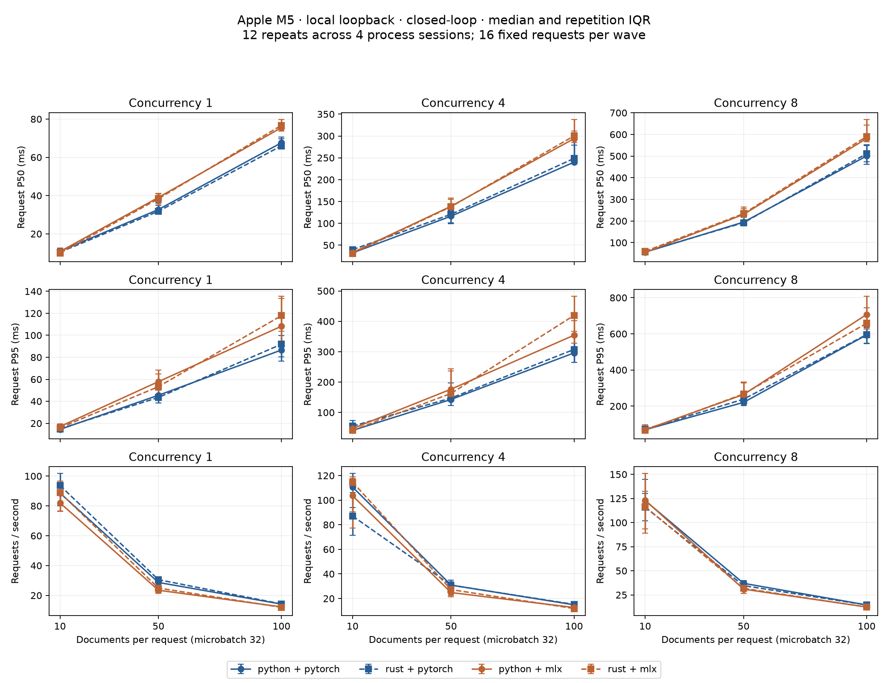
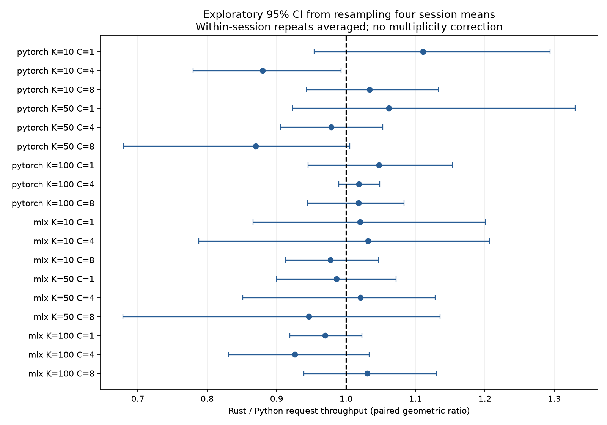

# E17: realistic inference and serving benchmarks

The original epoch-3 checkpoint, tokenizer, FP32 weights and 128-token limit are fixed. This evaluates implementation accuracy and inference performance; the scratch model remains a poor general reranker. No retraining or test-set tuning was performed.

## Measured conclusions

- No Rust throughput advantage is supported. Seventeen of eighteen coordinator throughput intervals include unity. One exploratory point (PyTorch, 10 documents, concurrency 4) favors Python: Rust/Python ratio 0.880 [0.779, 0.993]. Four sessions and uncorrected multiple comparisons make this a narrow local observation.
- Compiled PyTorch passed accuracy, but its complete-scoring throughput was lower than eager stock for the 50-document fixture: ratio 0.900 [0.811, 0.978], and 100-document fixture: 0.859 [0.837, 0.881]. All prepared-forward ratios and the 10-document complete-scoring comparison are inconclusive. These are offline microbatch-32 measurements, not compiled HTTP measurements.
- Compiled PyTorch's three changed full rankings have zero top-1, top-10 membership/order, nDCG@10 or MRR@10 changes. Numerical tolerances do not require bitwise-identical full rankings.
- Custom CUDA/Triton versus optimized stock on NVIDIA remains pending authentication. Historical overlapping ~1% differences cannot fill this gap.

## Contract and accuracy

The initial contract is retained in `plan_preflight.json`. Compile compatibility revealed an aggregation assumption before repeated performance collection; only code support for the additional compiled path was corrected, and the plan was re-frozen. Workloads, selection, tolerances and statistical methods were unchanged. Preflight incomplete scores were discarded; all reported audits and timings use the final frozen code.

The immutable `plan.json` was saved before measurements. Development inputs: 162 SciFact and 323 NFCorpus queries, each with fixed BM25 top-100 documents and complete qrels. Accuracy covers all 485 queries separately at K=10/50/100 (77,600 pairs per path); HTTP uses 16 preselected queries, eight per dataset. No candidate duplication or positive injection. The shared worker sorts input documents by ID before microbatch scoring; output ties use ascending document ID.

| Apple path | Strict numerical tolerance | Application gate | Max absolute error | Full ranking changes (across all K) |
|---|---|---|---:|---:|
| strict | pass | pass | 0 | 0 |
| stock | pass | pass | 0 | 0 |
| mlx | pass | pass | 4.0531158e-06 | 0 |
| compiled | pass | pass | 2.0265579e-06 | 3 |

Strict tolerance was predeclared as atol=1e-5, rtol=1e-4. Application acceptance requires every dataset/K cell to have max absolute score error ≤0.01, ≤1% top-1 and top-10 membership changes, and paired-query-bootstrap lower 95% bounds for nDCG@10/MRR@10 differences ≥−0.001. Full ranking/order changes, stabilized relative errors, per-query metrics and all scores are retained even when a path passes. The relative denominator is max(|reference|, 0.001); near-zero counts are disclosed. `mps_accuracy.json` contains all six cells per path and paired intervals. Passing these checks establishes agreement with this weak model, not good retrieval quality.

Profiler evidence: on this MPS installation both strict and stock settings execute `aten::_scaled_dot_product_attention_math_for_mps`; no fused stock encoder is observed. Therefore the enabled flag is not evidence of an Apple optimization. The two names disclose the requested settings; this is not a successful comparison of distinct fused MPS paths. CUDA fused-stock dispatch remains unmeasured.

`torch.compile` Inductor/fullgraph compatibility probe: **compatible**. See `mps_compile.json` for exact diagnostics. First-use wall time is separate and is not called cold compilation because disk cache state is unknown.

## Local loopback HTTP results

| Backend | Documents | Concurrency | Python P50 / P95 ms | Rust P50 / P95 ms | Python / Rust req/s | Rust/Python throughput ratio [95% session CI] |
|---|---:|---:|---:|---:|---:|---:|
| pytorch | 10 | 1 | 10.92 / 14.48 | 10.39 / 14.97 | 88.62 / 93.71 | 1.111 [0.954, 1.294] |
| pytorch | 10 | 4 | 32.43 / 40.90 | 39.71 / 54.93 | 110.65 / 87.07 | 0.880 [0.779, 0.993] |
| pytorch | 10 | 8 | 55.64 / 69.24 | 57.90 / 72.63 | 122.73 / 115.90 | 1.034 [0.943, 1.133] |
| pytorch | 50 | 1 | 32.72 / 45.48 | 31.79 / 43.50 | 28.68 / 30.53 | 1.061 [0.923, 1.330] |
| pytorch | 50 | 4 | 116.39 / 142.74 | 120.74 / 147.38 | 30.90 / 30.83 | 0.979 [0.905, 1.053] |
| pytorch | 50 | 8 | 194.86 / 220.80 | 192.01 / 238.49 | 36.98 / 34.60 | 0.870 [0.679, 1.005] |
| pytorch | 100 | 1 | 67.63 / 86.62 | 66.01 / 91.87 | 14.13 / 14.25 | 1.047 [0.945, 1.154] |
| pytorch | 100 | 4 | 240.05 / 296.07 | 248.54 / 307.50 | 14.86 / 15.19 | 1.019 [0.989, 1.049] |
| pytorch | 100 | 8 | 500.52 / 593.96 | 510.95 / 595.99 | 14.61 / 14.54 | 1.018 [0.944, 1.083] |
| mlx | 10 | 1 | 10.77 / 17.05 | 9.91 / 15.92 | 82.03 / 88.90 | 1.020 [0.866, 1.201] |
| mlx | 10 | 4 | 33.05 / 47.05 | 31.15 / 41.43 | 103.56 / 114.60 | 1.032 [0.788, 1.206] |
| mlx | 10 | 8 | 54.29 / 69.25 | 59.61 / 66.95 | 123.19 / 116.51 | 0.978 [0.913, 1.047] |
| mlx | 50 | 1 | 39.02 / 57.88 | 38.36 / 53.30 | 23.45 / 24.92 | 0.986 [0.900, 1.072] |
| mlx | 50 | 4 | 139.12 / 176.63 | 138.05 / 162.46 | 24.82 / 27.22 | 1.021 [0.851, 1.128] |
| mlx | 50 | 8 | 230.32 / 264.16 | 234.03 / 267.48 | 30.96 / 31.77 | 0.946 [0.679, 1.135] |
| mlx | 100 | 1 | 75.53 / 108.24 | 76.74 / 117.88 | 12.28 / 11.97 | 0.970 [0.919, 1.023] |
| mlx | 100 | 4 | 293.92 / 354.35 | 300.22 / 419.55 | 12.66 / 11.84 | 0.926 [0.830, 1.033] |
| mlx | 100 | 8 | 581.48 / 707.36 | 590.53 / 658.35 | 12.48 / 12.36 | 1.030 [0.939, 1.130] |

Completed 6,912 measured requests / 368,640 pairs; failures: 0. Every measured response is checked against its same-backend direct audit for scores and exact ranking. Raw observations retain returned IDs/scores, client latency, queue wait and processing time. P99, pair throughput, ranges/IQR and latency-difference intervals are in `summary.json`.

Exploratory throughput intervals excluding unity: pytorch K=10 C=4 (left advantage supported).
These intervals are conditional on four sessions on one machine and are not corrected for 18 comparisons. They cannot establish a universal coordinator advantage. Cross-backend differences include different framework execution, not only coordinator language.

## Timing and uncertainty

Twelve paired repeats per cell are spread over four independently started sessions. Startup ordering is balanced by a seeded Latin rotation. Each process warms with six realistic requests after the worker warmup. One model worker, bounded queue 32, microbatch 32, and no cross-request batching apply to every coordinator. Timeouts are 30 s request / 60 s worker. The exact E12 worker and its validation, tokenization, sorting, IPC and response contents are reused. Document count, pair microbatch and concurrent requests are independent dimensions.

Load is fixed-concurrency closed-loop on local loopback. Per-request latency ends at receipt of the HTTP response. Wave throughput includes client validation/scheduling overhead. Sixteen requests per wave give limited saturation and noisy P99 estimates; closed-loop load does not characterize open-loop overload or internet latency. Error bars in `http_workloads.png` show repetition IQR, not a confidence interval. `coordinator_uncertainty.png` shows paired throughput ratios and bootstrap intervals from four session means. Thousands of requests are never treated as thousands of independent benchmark runs.

Direct scoring separately flattens the selected queries and scores pair batches of 32, so boundaries may span queries; this is an offline scoring workload, not request batching in the server. `mps_direct_s*.json` separates prepared device-resident model forwards (synchronized, excludes CPU score conversion) from tokenization/transfer/model/CPU-score timing. Neither is labeled request latency. Historical E11/E14 isolated-operation results are not reused to claim new whole-model gains.

| Direct scope | Candidate count | Strict pairs/s | Stock flag pairs/s | MLX pairs/s | Stock/strict ratio [95% session CI] |
|---|---:|---:|---:|---:|---:|
| forward | 10 | 3821.1 | 4701.1 | 3201.1 | 1.122 [0.930, 1.375] |
| forward | 50 | 3384.9 | 3184.7 | 2658.6 | 0.917 [0.752, 1.070] |
| forward | 100 | 3212.7 | 3065.9 | 2286.1 | 0.958 [0.785, 1.110] |
| direct | 10 | 1607.2 | 2454.3 | 1765.5 | 1.369 [1.132, 1.741] |
| direct | 50 | 1219.6 | 1223.5 | 1123.3 | 1.006 [0.914, 1.149] |
| direct | 100 | 1340.8 | 1419.1 | 1079.0 | 1.054 [0.934, 1.202] |

| Compiled scope | Candidate count | Compiled pairs/s | Compiled/stock ratio [95% session CI] |
|---|---:|---:|---:|
| forward | 10 | 5027.0 | 1.069 [0.979, 1.203] |
| forward | 50 | 3558.9 | 1.097 [0.969, 1.281] |
| forward | 100 | 2762.5 | 0.988 [0.899, 1.117] |
| direct | 10 | 2611.6 | 1.092 [0.924, 1.320] |
| direct | 50 | 1158.3 | 0.900 [0.811, 0.978] |
| direct | 100 | 1132.0 | 0.859 [0.837, 0.881] |

Compiled measurements are direct inference only; the matched HTTP worker continues to use eager PyTorch. Accuracy qualification is reported above. A failing compiled path remains diagnostic, even if warm timing is lower. All workload shapes are materialized before timing; no compilation time is included in repeated forward/direct timings.

System snapshots record model/software versions, power source, thermal status and visible processes before/after sessions. Coordinator and worker RSS are sampled separately before/after; these are not peak memory and unified GPU memory may overlap RSS. Apple GPU clocks, temperature and utilization are not available from these snapshots. No exclusive hardware isolation is claimed. Startup/readiness times live in each raw HTTP file and include model loading/worker warmup; they are excluded from steady-state timing.

### Eager flag diagnostic and residual confounding

The strict/stock setting comparison at the 10-document offline fixture reported a stock/strict ratio 1.369 [1.132, 1.741], despite identical observed MPS attention dispatch and exact scores. It is not evidence that the fused-encoder fast path executed. To investigate the discrepancy, a separately labeled post-hoc diagnostic reused the same hot model, tokenizer and prepared input allocation for 24 balanced-order repetitions. It instead reported ratio 0.932 [0.864, 0.991], with exact score parity. That interval describes within-process variation only. The diagnostic does not replace the original observations or add independent sessions to their CI.

The advantage reverses between these setups. Residual process/model state, unobserved execution details and system variation remain possible causes; no cause is established. The eager flag gap is therefore not attributed to a named optimization. The session intervals are conditional sampling estimates and cannot account for all systematic confounding. See `flag_diagnostic.py` and `flag_diagnostic.json`.

All sampled sessions ran on AC power without recorded thermal/performance warnings. The largest measured HTTP latency was 2079.3 ms (rust/pytorch, K=50, C=8); its queue wait was 1109.5 ms and processing 954.2 ms. It remains in the raw data. `conditions_analysis.json` retains startup ranges, RSS samples and per-session throughput for drift inspection. A specific thermal or competing-GPU cause cannot be established.

## NVIDIA status and defensible conclusions

NVIDIA execution is complete on L40S (`dash2`): full accuracy audit, 15 paired repetitions across five balanced startup rotations, actual kernel dispatch evidence and 136 passing GPU tests. See [NVIDIA_REPORT.md](NVIDIA_REPORT.md) and [CUDA throughput plot](cuda_throughput.png). The unchanged original plan and the predeclared fifth-rotation supplement are retained.

Custom CUDA/Triton pass numerical/application gates but establish no throughput advantage over the strict baseline. Several differences favor strict PyTorch; others remain inconclusive. Fused stock and compiled PyTorch execute their optimizations but fail the predeclared top-10 membership gate at K=100, so their timings are diagnostic only. There is no accuracy-qualified custom-versus-fused winner. Apple M5 and NVIDIA L40S results cannot be interpreted as language-level speedups.

## Reproduction and artifacts

Run from the repository root with `.venv/bin/python -m experiments.E17.launch --device mps`. The frozen plan prevents unnoticed input/source changes. Existing complete outputs are skipped only after integrity checks; choose a new experiment for changes to the contract. Individual commands and NVIDIA launch guidance are in `launch.py` and `nvidia.sbatch`. Large gzip score/request audits remain local outside Git; `checksums.json` identifies every result. `verification.json` independently recomputes ranking, quality, request counts, percentiles, throughput and paired summaries.

Additional independent source audit checked all original cleaned/conflicting pairs for normalized query hashes, found zero original-training/test overlap with development, and checked every development query, candidate text and full qrel dictionary against official source files (`input_verification.json`). Core benchmark tests: 8 passed; supplemental NVIDIA provenance guards: 3 passed; reused HTTP/metrics: 19 passed; local CUDA/Triton guards: 15 passed, 121 GPU-dependent tests skipped. Both plots were visually inspected: correct ms/req/s units, unclipped labels, IQR versus CI distinguished, and no cross-hardware speedup claims (`plot_review.json`).

For the full report including this post-collection interpretation, run `python -m experiments.E17.finalize_report` after `launch`, then `python -m experiments.E17.verify` to refresh all result checksums. For only saved-record verification, run `verify`; no GPU is required. Large per-query gzip scores and full per-request JSON audits remain ignored locally; compact per-repetition timing observations are committed in `http_timing_raw.json` and `mps_direct_s*.json`.

The existing CUDA source and shared-library bytes match their E14 hashes locally (`nvidia_provenance.json`); this is an asset guard, not GPU execution or accuracy validation. `nvidia_provenance_plan.json` supplements the unchanged Apple contract, and `nvidia.sbatch` checks its hashes and L40S access before execution.

NVIDIA launch, fifth-rotation supplement, saved-result verification and post-timing GPU tests are documented in [NVIDIA_REPORT.md](NVIDIA_REPORT.md). All three Slurm jobs completed with exit code 0:0; no other person’s session or job was altered.
