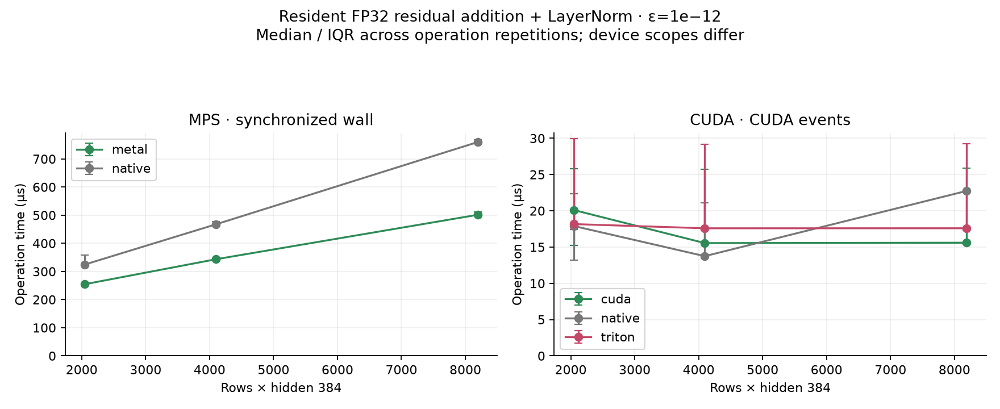
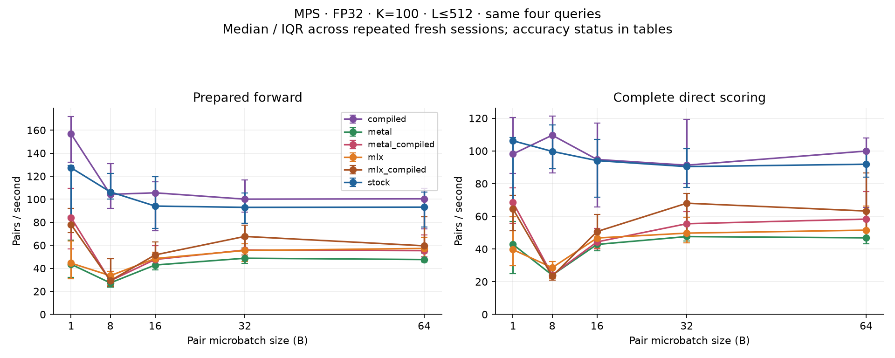
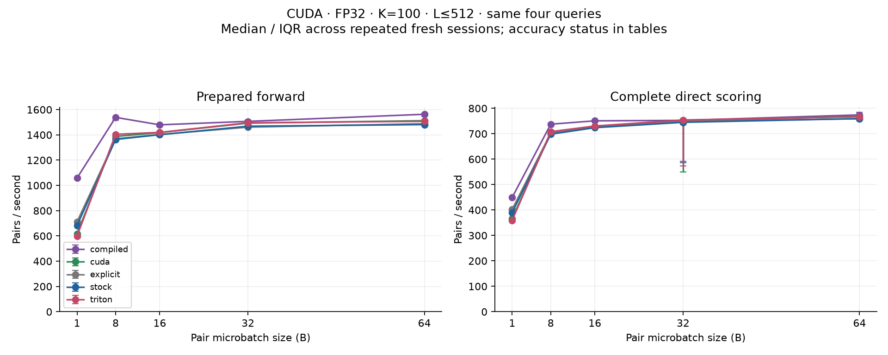
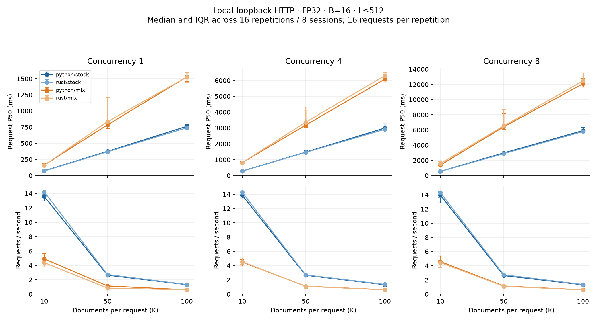
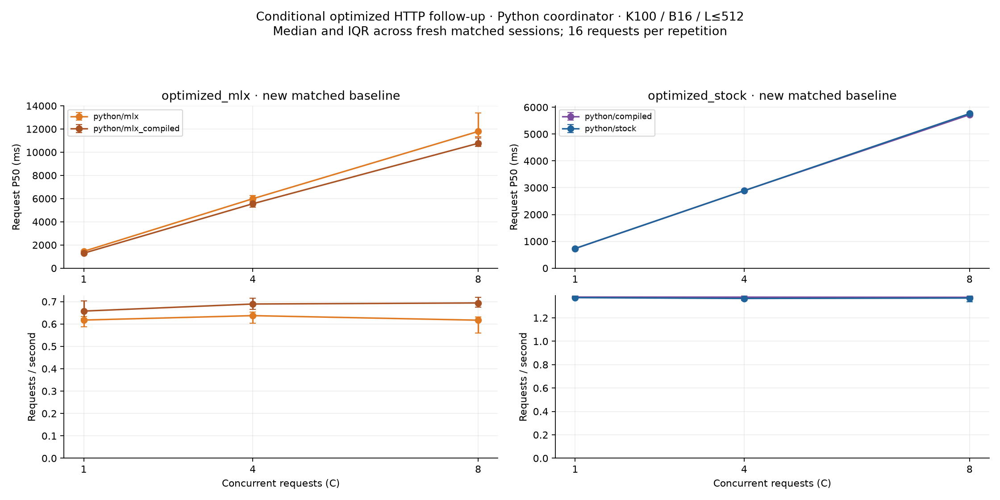

# 13 Performance Experiments on One Reranker: The Limits of Faster GPU Code

*Benchmarking compilation, custom kernels, batching, and serving on Apple M5 and NVIDIA L40S*

I wanted to learn how inference optimization works in practice, so I picked a pretrained reranker and tried different ways to run it faster. I compared PyTorch and MLX, tried compilation, wrote custom GPU kernels, and tested Python and Rust serving. Across 13 experiments on an Apple GPU and an NVIDIA GPU, I measured which changes helped and whether those improvements held up when serving requests.

I used **cross-encoder/ms-marco-MiniLM-L6-v2**, a pretrained reranker with about **22.7 million parameters**. A reranker takes a query and a set of candidate documents, scores each query–document pair, and orders the documents by relevance.

I kept the model weights unchanged throughout. The experiments focused on execution: frameworks, compilation, custom kernels, batching, and serving. I ran the Apple experiments on my **MacBook’s M5 GPU** and the NVIDIA experiments on an **L40S in a remote cluster**. Each optimization was compared against a baseline on the same device.

I measured performance at three levels:

| Level | What I timed |
|---|---|
| Individual GPU operation | Residual addition and LayerNorm on prepared tensors |
| Complete document scoring | Tokenization, input transfer, the full model forward pass, and returning scores to the CPU |
| Complete HTTP request | Request handling, queueing, scoring, document sorting, and returning the response |

These levels fit inside each other:

```text
HTTP request
└── Complete document scoring
    └── Model execution
        └── Individual GPU operations
```

A change could help at one level without producing a measurable improvement at the next. Keeping those measurements separate helped me understand what an optimization had achieved.

## How I measured improvements

The primary scoring workload used **100 documents per query, a pair batch size of 16, and a maximum combined query–document length of 512 tokens**. The implementation comparisons used FP32. Model batches, documents per request, and concurrent requests are three different settings; I changed them separately.

Candidates came from fixed BM25 retrieval results on SciFact and NFCorpus development data. I did not inject positive documents into the candidate lists. Primary timing used 16 predetermined queries, while secondary sweeps used four. The accuracy audit was larger: 485 queries at each of 10, 50, and 100 candidates, totaling 77,600 query–document pair occurrences per implementation.

I checked numerical agreement and ranking behavior before accepting timing results. All 11 implementation audits passed the declared checks. There were no top-1 or top-10 membership changes, although some nearly tied documents changed order. Passing these checks means the differences stayed within the declared limits; the outputs were not always identical.

For primary direct scoring, I collected 18 paired repetitions across six Apple sessions and 15 across five NVIDIA sessions. The reported performance intervals use independently started sessions, rather than treating every document as an independent trial. They are exploratory 95% intervals, without correction for the many comparisons in the study.

I also set a practical rule before collecting headline results: the lower interval bound had to exceed a **5% improvement** to qualify as a practical win. A small measurable difference could therefore pass the statistical comparison without changing my implementation choice.

## Experiment 1: PyTorch versus MLX on Apple M5

I started by measuring complete document scoring with stock PyTorch and MLX. I also measured complete HTTP requests using a Python coordinator at concurrency one.

| Framework | Direct scoring: pairs/sec ↑ | HTTP: pairs/sec ↑ | HTTP: requests/sec ↑ | HTTP: P50 latency ↓ |
|---|---:|---:|---:|---:|
| PyTorch | **87.4** | **132.0** | **1.320** | **762.1 ms** |
| MLX | **40.7** | **61.1** | **0.611** | **1,526.5 ms** |

*Apple M5; 100 documents per query; batch size 16; maximum 512 tokens; warm execution.*

Direct scoring excludes HTTP handling and sorting. The HTTP measurements include those stages, plus queueing and returning the response. I did not isolate sorting or HTTP overhead as individual benchmarks.

The two columns came from separate benchmark runs with different execution patterns. Their absolute throughput values cannot be subtracted to estimate HTTP overhead. The higher HTTP throughput does not mean HTTP accelerated inference. The supported comparison is between frameworks within each measurement setting.

PyTorch outperformed MLX in both settings for this model on my M5. One relevant implementation detail was attention: MiniLM has a head dimension of 32, which the installed MLX version’s fused full-attention kernel did not support. Runtime checks and dispatch evidence showed the mathematical fallback. This result describes the implementations I measured, rather than a general advantage for every PyTorch workload.

## Experiment 2: Compiling PyTorch

Next, I tried `torch.compile` while keeping the model weights and primary workload fixed.

| Hardware | Stock pairs/sec | Compiled pairs/sec | Paired improvement | 95% interval |
|---|---:|---:|---:|---:|
| Apple M5 | 87.4 | **102.1** | **13.7%** | 8.1%–19.8% |
| NVIDIA L40S | 712.4 | **736.8** | **3.3%** | 3.2%–3.4% |

The percentage estimates come from paired comparisons within repetitions. They differ from dividing the separately calculated throughput medians in the table.

Compilation passed the accuracy checks on both devices. On Apple, it was a practical improvement for warm direct scoring. On NVIDIA, the improvement was smaller and did not clear the predefined practical threshold. The frozen selection rule therefore retained stock PyTorch as the practical NVIDIA baseline, even though compiled PyTorch had the fastest measured primary scoring throughput.

The stock baseline already used PyTorch’s SDPA attention implementation. On NVIDIA, profiling recorded memory-efficient SDPA; on Apple, it recorded native MPS SDPA math. I did not treat using the SDPA API as proof of FlashAttention.

## Experiment 3: Compiling MLX

I also tested MLX compilation on Apple.

| Implementation | Median direct-scoring pairs/sec |
|---|---:|
| MLX | 40.7 |
| Compiled MLX | **48.9** |

The paired improvement was **25.3%**, with a 95% interval of **13.9%–37.9%**. Compiled MLX passed the accuracy checks and was selected as the best measured MLX configuration under the frozen rule.

That gain did not make it the fastest framework in the study: compiled PyTorch remained faster on the primary Apple workload. Improving an implementation and choosing between frameworks are separate decisions.

## Experiment 4: A custom Metal kernel

For the Apple kernel experiment, I fused **residual addition and LayerNorm**. The residual addition combines a layer’s output with its input; LayerNorm normalizes the resulting values. A fused kernel can perform both in one GPU operation, reducing intermediate work and dispatches.

I adapted the kernel to the pretrained model’s hidden size of 384 and its LayerNorm settings, then checked synthetic inputs and real model activations.

| Input shape | Native MLX operation | Custom Metal operation | Paired speedup |
|---|---:|---:|---:|
| 2,048 × 384 | 324.5 µs | **254.5 µs** | 1.406× |
| 4,096 × 384 | 467.2 µs | **343.1 µs** | 1.377× |
| 8,192 × 384 | 759.7 µs | **501.3 µs** | 1.499× |

All three operation comparisons supported an improvement. These Apple timings include dispatch and synchronization; the paired ratios are calculated separately from the displayed medians.

Then I put the kernel inside the model:

| Apple implementation | Median direct-scoring pairs/sec |
|---|---:|
| MLX | 40.7 |
| MLX with custom Metal | 37.1 |
| Compiled MLX | 48.9 |
| Compiled MLX with custom Metal | 52.5 |

Neither custom-versus-native model comparison established a scoring improvement. The MLX/custom-Metal paired ratio was **0.909 [0.799, 1.015]**; the compiled-MLX/compiled-Metal ratio was **0.966 [0.821, 1.187]**. Both intervals included parity.

This was the clearest example of why I needed more than an operation benchmark. The kernel became faster in isolation, but I could not establish that it made complete document scoring faster.



## Experiment 5: A custom CUDA kernel

On NVIDIA, I implemented the same residual-plus-LayerNorm intervention in CUDA and compared it against both stock PyTorch and an explicit matched graph. The explicit graph agreed exactly with stock scores, which helped check the implementation comparison.

| NVIDIA implementation | Median direct-scoring pairs/sec |
|---|---:|
| Stock PyTorch | 712.4 |
| Explicit matched graph | 712.7 |
| Custom CUDA | 715.0 |
| Compiled stock PyTorch | **736.8** |

The custom CUDA path passed the accuracy audit. Its gain over stock was small, and it was slower than compiled stock: the paired compiled/custom throughput ratio was **0.971 [0.969, 0.974]**.

At the operation level, results depended on shape. CUDA regressed at the two smaller tested row counts and improved at the largest. The operation benchmark did not support a universal advantage for the custom implementation.

I also tried combining the CUDA adapter with full-graph compilation. That attempt was unsupported because the adapter’s ctypes/data-pointer interface broke tracing. It was retained as an implementation limitation, rather than counted as a completed timing path.

## Experiment 6: A custom Triton kernel

I wrote the same fused operation in Triton and ran it on the NVIDIA L40S.

| NVIDIA implementation | Median direct-scoring pairs/sec |
|---|---:|
| Stock PyTorch | 712.4 |
| Custom CUDA | 715.0 |
| Custom Triton | 717.5 |
| Compiled stock PyTorch | **736.8** |

Triton passed the accuracy checks, but it did not beat compiled stock PyTorch. The paired compiled/Triton ratio was **0.975 [0.972, 0.978]**. Isolated operation results also varied with shape and did not establish a consistent improvement.

Profiling helped put the intervention in context. In one selected-query CUDA profile, all 13 LayerNorm kernels accounted for roughly **1.9% of summed leaf GPU-kernel time**. Twelve residual normalizations were eligible for fusion; the embedding normalization was not. Residual-addition time was outside that 1.9%, so the figure is not an upper bound on the fusion opportunity.

Tokenization dominated that query’s synchronized stage breakdown. This was a selected-query diagnostic, rather than a fraction measured over every query or HTTP request. It showed why optimizing one model operation could have limited reach, without establishing the cause of every timing difference.

## Experiment 7: Increasing the pair batch size

I swept batch sizes **1, 8, 16, 32, and 64** at 100 documents per query and the 512-token cap.

Here are representative stock and compiled PyTorch results from the secondary scoring sweep:

| Pair batch size | Apple stock pairs/sec | Apple compiled pairs/sec | NVIDIA stock pairs/sec | NVIDIA compiled pairs/sec |
|---|---:|---:|---:|---:|
| 1 | 106.2 | 98.1 | 389.5 | 449.2 |
| 8 | 99.7 | 109.6 | 698.3 | 737.6 |
| 16 | 94.1 | 94.8 | 723.9 | 750.8 |
| 32 | 90.4 | 91.3 | 744.9 | 752.7 |
| 64 | 91.9 | 99.9 | 759.6 | 774.2 |

*These are four-query diagnostic sweeps, separate from the primary timing collection. Secondary batch sizes did not receive the complete primary accuracy audit.*

On NVIDIA, batch size one was costly. Larger batches increased throughput, with gains becoming smaller toward the upper end of the sweep.

Apple’s results were non-monotonic: batch size one sometimes exceeded larger batches. Dynamic padding and framework execution change with batch size, and I did not establish a causal explanation. I retained the frozen primary batch size of 16 rather than claiming it was globally optimal.





## Experiment 8: Changing the documents per request

A pair batch is the amount processed in one model batch. A request can contain more documents than that, requiring multiple batches. I tested requests containing **10, 50, and 100 documents**.

These Apple results use the Python coordinator at concurrency one:

| Documents per request | PyTorch P50 | PyTorch requests/sec | MLX P50 | MLX requests/sec |
|---|---:|---:|---:|---:|
| 10 | 73.9 ms | 13.61 | 161.5 ms | 4.92 |
| 50 | 374.1 ms | 2.64 | 785.2 ms | 1.14 |
| 100 | 762.1 ms | 1.320 | 1,526.5 ms | 0.611 |

More documents meant more work per request and fewer completed requests per second. That is why a requests-per-second number needs its document count next to it. A service processing 100-document requests is doing a different amount of work from one processing 10-document requests.

This sweep also made the framework difference visible in latency: PyTorch was faster at all three request sizes in this setup.

## Experiment 9: Shortening the token limit

I tested maximum lengths of **128, 256, and 512 tokens**. Shorter inputs reduced computation, but also removed information from documents.

| Token cap | Apple stock pairs/sec | Apple compiled pairs/sec | NVIDIA stock pairs/sec | NVIDIA compiled pairs/sec |
|---|---:|---:|---:|---:|
| 128 | 370.2 | 409.2 | 1,200.0 | 1,217.3 |
| 256 | 212.7 | 206.8 | 1,000.9 | 1,059.4 |
| 512 | 94.1 | 94.8 | 723.9 | 750.8 |

*Secondary four-query scoring sweeps; 100 documents per query and batch size 16. These are diagnostic comparisons, not fully accuracy-qualified replacements for the primary workload.*

The speed difference was substantial, especially on Apple. But the untruncated median input lengths in the K100 timing fixture were 383 tokens for SciFact and 358.5 for NFCorpus. A 128-token cap truncated almost every pair.

On a separate 16-query context-quality diagnostic, the L128-minus-L512 nDCG@10 difference was **−0.0165**, with an interval of **[−0.0700, 0.0178]**. MRR@10 differed by **−0.0365 [−0.1927, 0.0835]**. At 256 tokens, the nDCG difference was **+0.0017 [−0.0053, 0.0111]**.

Those broad intervals did not establish application-equivalent quality. I kept 512 tokens for primary comparisons. Shorter context can be a useful tradeoff, but changing the task input needs a quality decision alongside the timing result.

## Experiment 10: Python versus Rust serving

I compared Python and Rust HTTP coordinators using the **same Python inference worker**. Rust handled coordination; it did not replace the model implementation. Request validation, sorting, response contents, and timeouts were matched.

| Backend | Documents | Python P50 | Rust P50 | Python / Rust requests/sec |
|---|---:|---:|---:|---:|
| PyTorch | 10 | 73.9 ms | 71.0 ms | 13.61 / 14.24 |
| PyTorch | 50 | 374.1 ms | 367.5 ms | 2.64 / 2.73 |
| PyTorch | 100 | 762.1 ms | 739.4 ms | 1.320 / 1.343 |
| MLX | 10 | 161.5 ms | 158.2 ms | 4.92 / 4.40 |
| MLX | 50 | 785.2 ms | 835.0 ms | 1.14 / 0.85 |
| MLX | 100 | 1,526.5 ms | 1,524.2 ms | 0.611 / 0.607 |

*Apple loopback HTTP, concurrency one, batch size 16, maximum 512 tokens.*

Across the full document-count/concurrency matrix, Rust’s PyTorch comparisons favored Rust in six of nine exploratory intervals. The estimated gains were about 2–4%, and none cleared the practical 5% criterion. MLX coordinator differences were mostly inconclusive, with one point favoring Python.

P50 and throughput can move differently: slower requests affect total elapsed time even when the median request becomes slightly faster. These measurements did not establish a universal language advantage or justify switching coordinators solely for throughput.

## Experiment 11: Increasing concurrency

I tested **1, 4, and 8 simultaneous requests**. The service used one inference worker and did not batch documents across requests.

For 100-document requests with the Python coordinator:

| Concurrent requests | PyTorch P50 | PyTorch requests/sec | MLX P50 | MLX requests/sec |
|---|---:|---:|---:|---:|
| 1 | 762.1 ms | 1.320 | 1,526.5 ms | 0.611 |
| 4 | 2,997.2 ms | 1.319 | 6,081.4 ms | 0.619 |
| 8 | 5,916.9 ms | 1.316 | 12,079.7 ms | 0.607 |

Throughput barely changed while latency rose. At concurrency four, Python/PyTorch’s median queue wait was about **2,240 ms**, compared with about **755 ms** of processing time. Requests were mostly waiting for the serialized worker.

This is a result about this service architecture. It does not establish how multiple workers or cross-request batching would behave. The client also used closed-loop load: a new request followed a completed one within each concurrency slot. I did not test open-loop overload.



## Experiment 12: Did compilation help HTTP serving?

After finding direct-scoring gains, I measured compiled backends behind HTTP. Each follow-up started new matched baseline workers. I compared within those families rather than borrowing baseline measurements from the earlier coordinator study.

For 100 documents per request:

| Backend comparison | Concurrency | Stock P50 | Compiled P50 | Paired throughput improvement | 95% interval |
|---|---:|---:|---:|---:|---:|
| PyTorch | 1 | 734.3 ms | 731.3 ms | −0.5% | −1.5%–0.5% |
| PyTorch | 4 | 2,889.9 ms | 2,890.1 ms | 0.3% | −1.0%–1.6% |
| PyTorch | 8 | 5,763.9 ms | 5,721.6 ms | 1.0% | about 0.01%–2.1% |
| MLX | 1 | 1,453.1 ms | 1,292.5 ms | **11.2%** | 6.2%–17.1% |
| MLX | 4 | 5,987.4 ms | 5,555.2 ms | **10.0%** | 2.3%–17.2% |
| MLX | 8 | 11,789.0 ms | 10,766.1 ms | **15.7%** | 10.3%–22.1% |

Compiled PyTorch’s direct-scoring improvement did not produce a practical HTTP gain. Concurrency one and four were inconclusive; concurrency eight showed a small exploratory effect below the practical threshold.

Compiled MLX improved its own HTTP baseline. Concurrency one and eight cleared the practical criterion; concurrency four’s lower bound did not. Even after compilation, MLX remained slower than PyTorch in the matched service measurements.

I could observe that the PyTorch gain did not carry through, but I did not establish one cause for the discrepancy. The direct and HTTP execution patterns differ, so these results cannot be used to assign an exact fraction to HTTP overhead.



## Experiment 13: Startup cost and amortization

Warm throughput leaves out the cost of reaching that state. I measured first scoring with fresh software-cache directories:

| Hardware | Stock first scoring | Compiled first scoring |
|---|---:|---:|
| Apple M5 | **0.51 s** | 7.68 s |
| NVIDIA L40S | **0.46 s** | 24.74 s |

These were single ordered startup pairs. Fresh software caches do not clear all system shader or driver caches, and GPU driver cache state was unknown. The results illustrate overhead; they do not provide startup confidence intervals or fully cold-start estimates.

Using the observed model-setup-plus-first-score difference and median paired warm saving gave illustrative amortization estimates of about **41 K100 queries on Apple** and **11,287 on NVIDIA**. They are not production break-even predictions, and the Apple direct-scoring estimate does not imply an HTTP break-even point.

Startup mattered more when the warm improvement was small. It belongs alongside throughput when choosing an implementation for a short-lived process.

## What I would use after these experiments

| Question | Decision supported by this study |
|---|---|
| Warm direct scoring on Apple? | Compiled PyTorch |
| Best measured MLX configuration? | Compiled MLX; it also improved its own HTTP baseline |
| NVIDIA implementation under the practical selection rule? | Stock PyTorch; compiled stock had a small measured lead |
| Custom residual-plus-LayerNorm kernels for model throughput? | No established reason to adopt them over the strongest measured stock configurations |
| Rust coordinator for throughput? | No practical advantage established in this service |
| Increase concurrency to improve throughput? | It mostly increased queueing with the single worker |
| Shorten inputs for speed? | Only with a separate quality decision; equivalence was not established here |

The custom-kernel work was useful for learning. It required checking real activations, matching numerical behavior, profiling the model, and comparing against an existing optimized implementation. But a faster isolated operation was insufficient evidence for changing the complete inference path.

Compilation was the clearest successful intervention for Apple direct scoring. The serving experiments added another requirement: measure the complete request before claiming an application improvement.

## What this study does not establish

This is one pretrained model on two hardware environments. It does not establish that the model’s size caused the results, that custom kernels are generally ineffective, or that one framework is universally faster.

The HTTP study used local loopback requests on Apple. NVIDIA HTTP, HTTPS/TLS overhead, mixed precision, open-loop overload, distributed serving, and cross-request batching were not measured. Each HTTP repetition contained 16 requests, so the highest-concurrency runs had only two waves; their P99 values cannot characterize production tails.

The timing fixtures were deliberately small enough to repeat. Secondary batch and context sweeps were diagnostic and did not receive the complete primary accuracy audit. The retrieval metrics describe these development candidates; training overlap is unknown, so this is not a leaderboard evaluation of the model.

Other machine activity was visible, exclusive isolation and fixed GPU clocks were not established, and Apple temperature/clock measurements were unavailable. Memory snapshots were process RSS measurements, not total-system peak memory.

Across the accepted HTTP runs, **12,288 responses passed score and ranking validation, with no measured failures or timeouts**. That supports correctness for the tested protocol; it does not establish behavior under production load.

## Closing thought

I started this project to understand what the different performance tools let me do. By the end, I had a better way to decide whether a change was useful: check that it preserves the intended output, repeat the measurement, and time the amount of work the application needs to complete.

Some changes helped. Some made one operation faster without establishing a model improvement. Others showed small differences that did not justify adding complexity. Measuring all three levels made those distinctions visible.

## Results and reproduction

The detailed [report](REPORT.md), [measured tables](RESULTS.md), and [frozen protocol](plan.json) contain the full comparisons, accuracy checks, implementation details, and reproduction instructions. The published figures in this draft are generated from the saved E18 results.

The 13 sections group comparisons from the E18 study; they are not 13 independently preregistered studies. This article covers **E18-small-v1**, collected on October 10–11, 2026, using pinned model revision `233902d25c440f23af6f7d6e94d2946bac0bee0a`.
